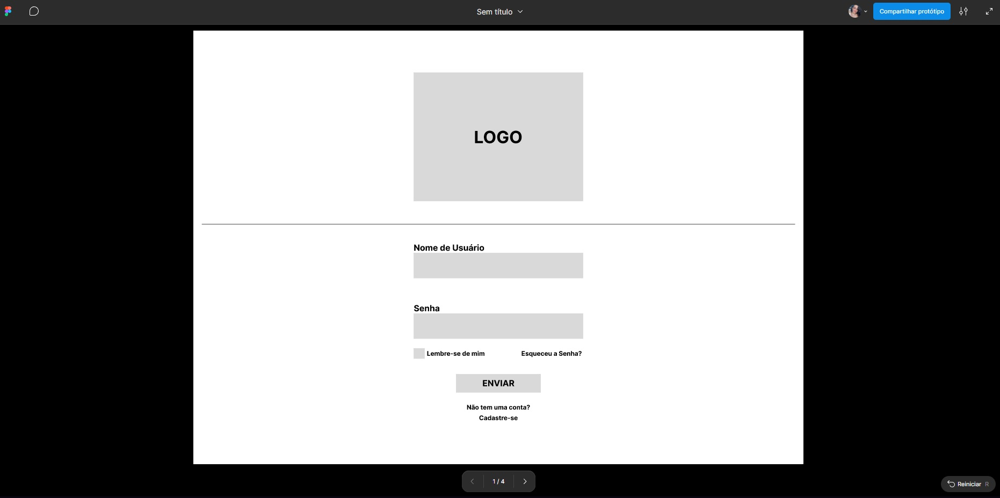
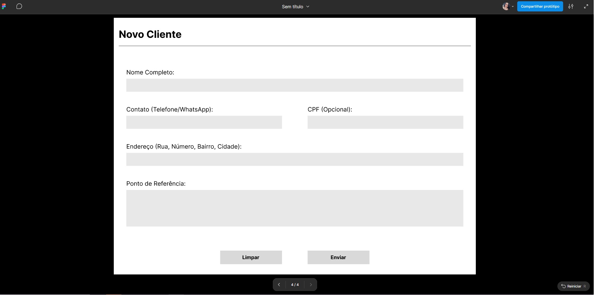
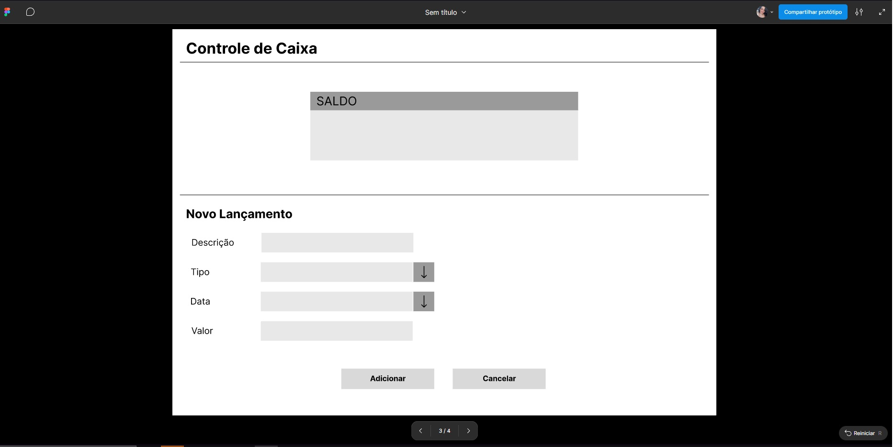
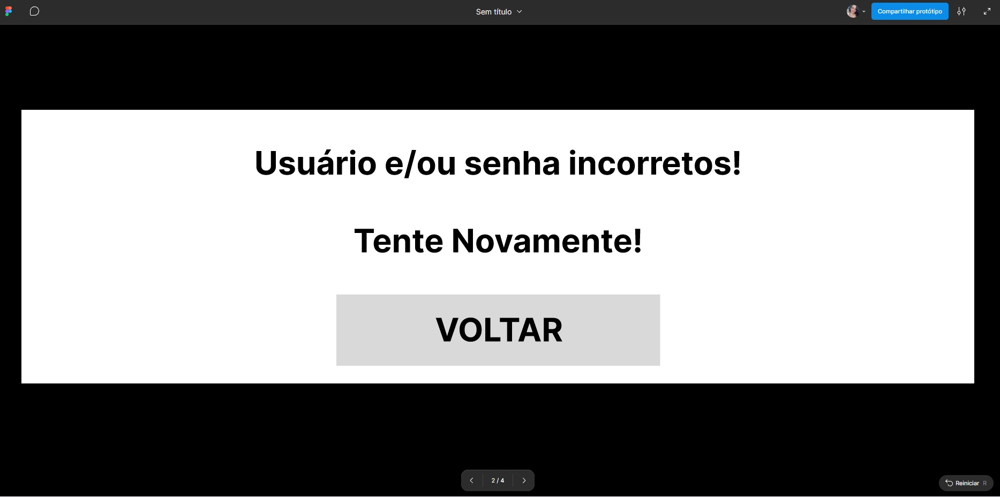

# UX/UI — Wireframes e Protótipo de Pizzaria

Projeto de UX/UI desenvolvido para praticar a análise de necessidades, organização de fluxos e criação de telas para um sistema de atendimento e controle de caixa.

## Sobre o projeto

O material apresenta wireframes e telas de um fluxo de uso com login, tratamento de erros, cadastro de clientes e controle de caixa. As telas foram organizadas para demonstrar decisões de arquitetura da informação, usabilidade e clareza visual.

## Tecnologias e ferramentas

- Figma
- UX Research e levantamento de necessidades
- Arquitetura da informação
- Wireframes
- Prototipagem de interfaces

## Telas do projeto

### Login

### Cadastro de cliente

### Controle de caixa

### Tratamento de erro

## Competências demonstradas

- Figma
- Design de experiência do usuário (UX)
- Design de interface do usuário (UI)
- Wireframing
- Prototipagem de interfaces

## Observação

Este repositório contém somente os materiais de portfólio selecionados. Arquivos acadêmicos, documentos pessoais e materiais não relacionados ao projeto foram mantidos fora da publicação.
